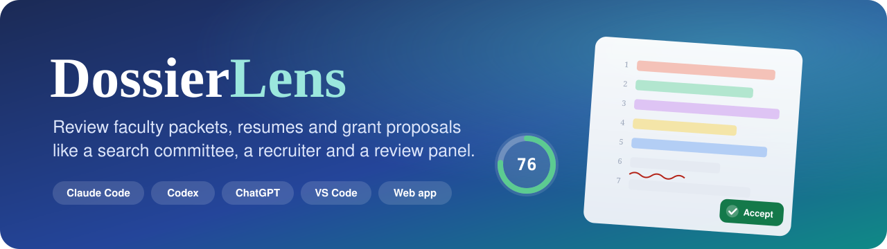
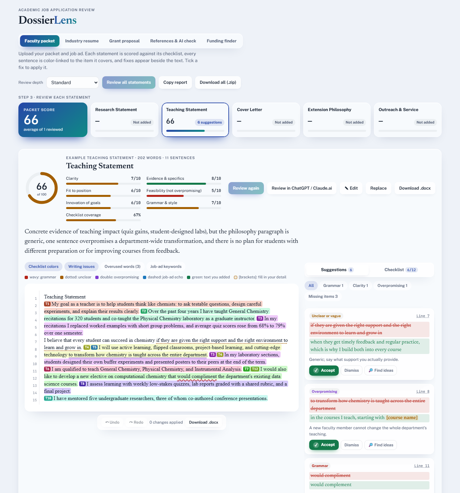
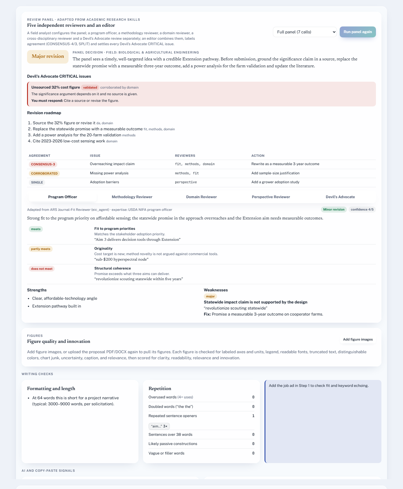
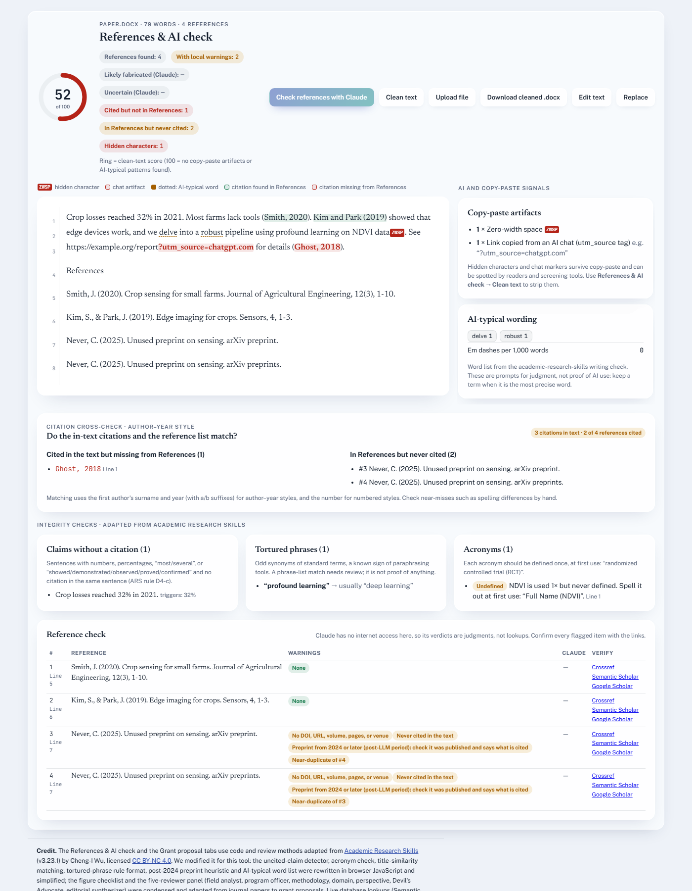
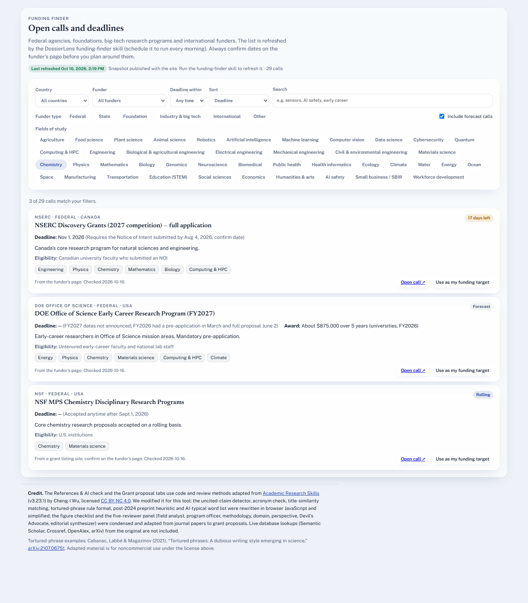
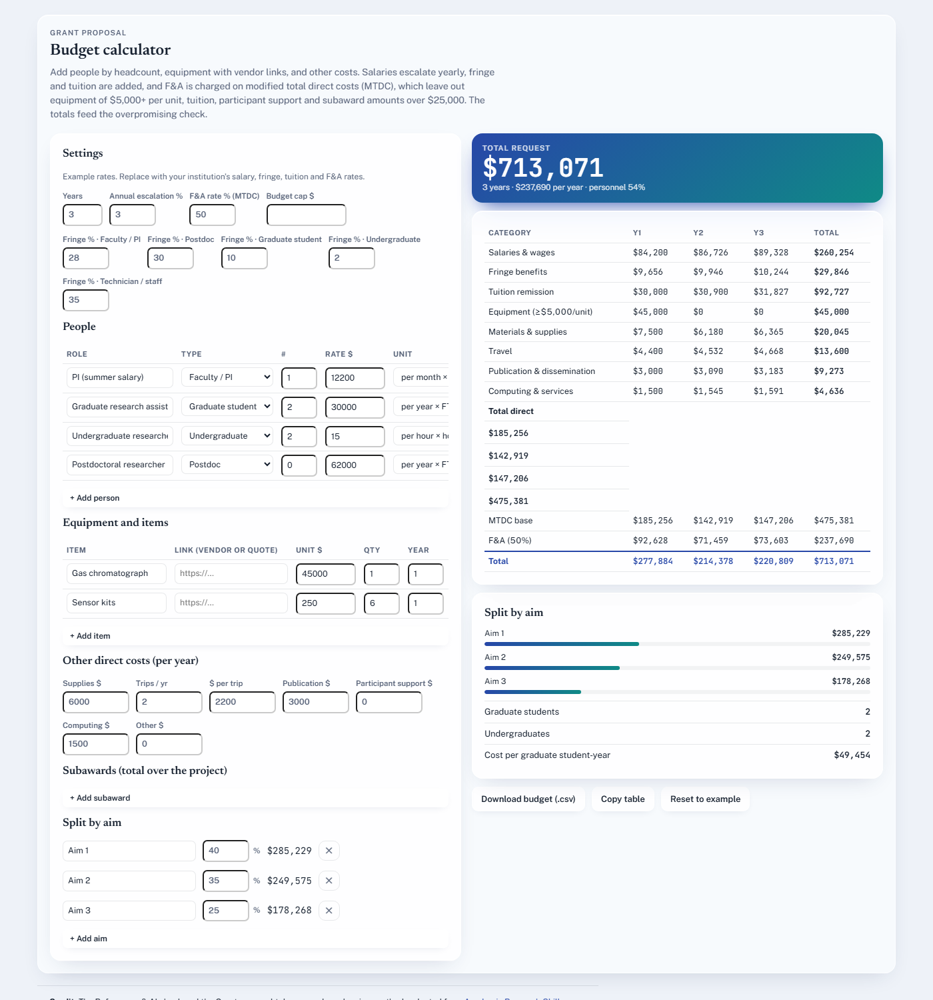
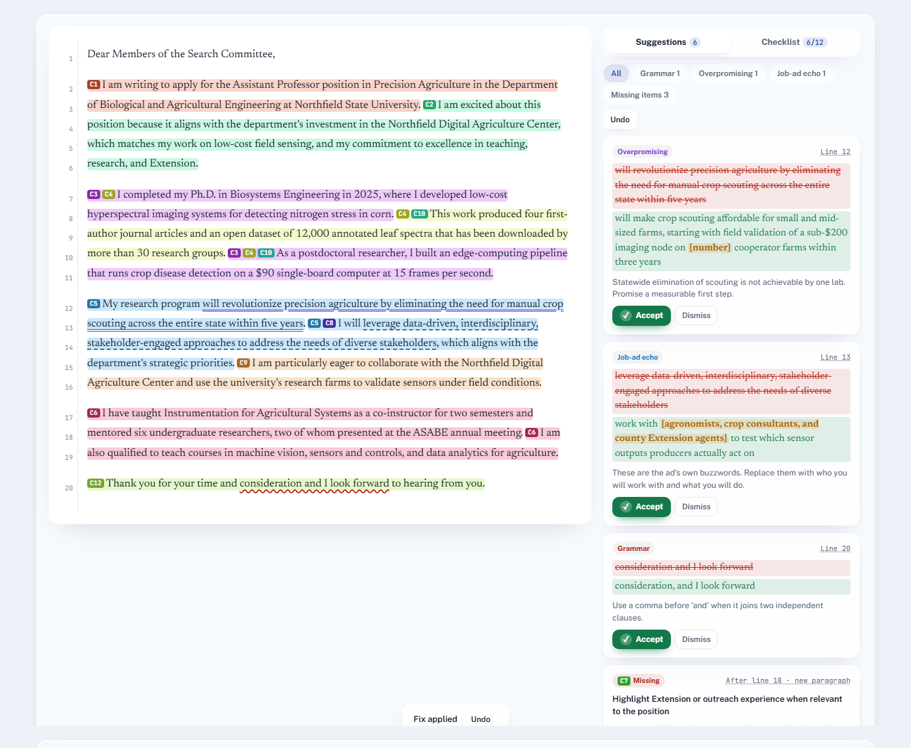
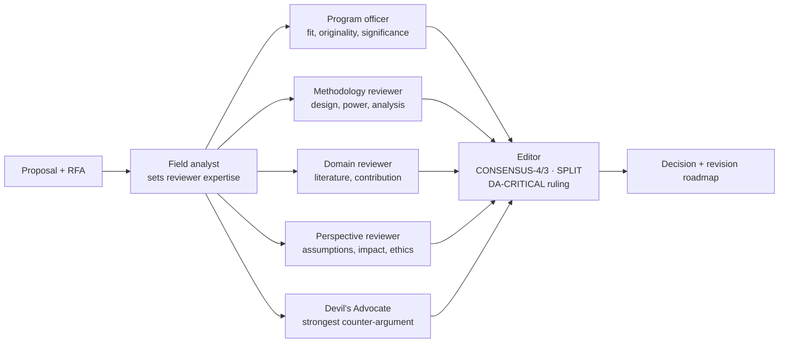

<p align="center">
  
</p>

<p align="center">
  <a href="https://chaitanya-pallerla.github.io/dossierlens/"></a>
  <a href="#1-claude-code-terminal"></a>
  <a href="#4-codex-cli-sign-in-with-chatgpt"></a>
  <a href="#6-chatgpt-custom-gpt-or-project"></a>
  <a href="LICENSE"></a>
</p>

<p align="center"><b>DossierLens</b> reviews your <b>faculty job application</b>, <b>industry resume</b> and <b>grant proposal</b> the way a search committee, a recruiter and a review panel would.<br>
It scores every document against detailed checklists, points to the exact line that needs work, and gives you fixes you can accept with one tick.<br>
Use it with your own <b>Claude</b>, <b>ChatGPT / Codex</b> account, inside <b>VS Code</b>, or in the browser.</p>

---

## Contents

- [What it does](#what-it-does)
- [Screenshots](#screenshots)
- [Pick how you want to use it](#pick-how-you-want-to-use-it)
  - [1. Claude Code (terminal)](#1-claude-code-terminal)
  - [2. Claude Code in VS Code or JetBrains](#2-claude-code-in-vs-code-or-jetbrains)
  - [3. Claude desktop app](#3-claude-desktop-app)
  - [4. Codex CLI (sign in with ChatGPT)](#4-codex-cli-sign-in-with-chatgpt)
  - [5. Codex in VS Code, Cursor or the Codex app](#5-codex-in-vs-code-cursor-or-the-codex-app)
  - [6. ChatGPT (custom GPT or Project)](#6-chatgpt-custom-gpt-or-project)
  - [7. Claude.ai Projects](#7-claudeai-projects)
  - [8. The web app](#8-the-web-app)
  - [9. Command line only](#9-command-line-only)
  - [10. Other AI tools (Cursor, Copilot, Gemini CLI…)](#10-other-ai-tools-cursor-copilot-gemini-cli)
- [Commands and skills](#commands-and-skills)
- [Example session](#example-session)
- [How the grant review panel works](#how-the-grant-review-panel-works)
- [Refresh the funding list every morning](#refresh-the-funding-list-every-morning)
- [Privacy](#privacy)
- [Limitations](#limitations)
- [FAQ](#faq)
- [Project structure](#project-structure)
- [License, credits and citation](#license-credits-and-citation)

---

## What it does

| | Area | What you get |
|---|---|---|
| 🎓 | **Faculty packet** | Research statement (16 checks), teaching statement (12), cover letter (12), Extension philosophy (12), outreach & service (12). Scores for clarity, evidence, fit, feasibility, innovation and writing. A **"does the cover letter say *why me*?"** verdict. Finds statements inside one combined file or a `.zip` by their headings. |
| 💼 | **Industry resume** | 12 **ATS-friendly** checks (tables, columns, images, header contact info, dates, keywords) and 13 **strong-format** checks (action verbs, numbers in bullets, length, tense), measured from the actual `.docx` / PDF. Bullet rewrites in the *action + what + measurable result* pattern. |
| 🧪 | **Grant proposal** | Reads the **RFA / solicitation** and checks page limits, formatting, required sections and review criteria. **Overpromising audit** of expertise, timeline and cost. Figure review. A **five-reviewer panel with a Devil's Advocate**. Field-of-study suggestions. Comparison with **recently funded proposals**. |
| 💰 | **Budget calculator** | People by headcount, equipment with vendor links, travel and other costs; yearly escalation, fringe, tuition, **F&A on MTDC**, subawards, a **split by aim**, cap warnings and CSV export. |
| 🔎 | **References & AI check** | **Two-way citation check**: cited but not in References, and in References but never cited, with line numbers. Likely fabricated references, post-2024 preprints, near-duplicates, claims without citations, undefined acronyms, tortured phrases. **ChatGPT copy-paste traces** (hidden zero-width characters, `oaicite` markers, `utm_source=chatgpt.com` links, stray Markdown) with one-click cleaning. |
| 📅 | **Funding finder** | Open calls from NSF, NIH, USDA, DOE, DARPA, NASA, foundations, **big-tech research programs** and international funders. Filters by field (and **combinations like robotics + food**), country (USA by default), funder type and deadline. |

Every review uses the same format:

- **Scorecard:** six 1-10 scores, checklist coverage and an overall score out of 100.
- **Checklist:** each item is marked ✅ met, ◐ partly met or ❌ missing, with **line numbers**.
- **Numbered suggestions:** each shows the exact words, the replacement and the reason, including drafts for missing items with `[placeholders]` for facts only you know.
- **Accept flow:** reply `apply 1 3 5`, `apply all` or `apply all grammar` and you get a revised file plus a **Word (.docx)** copy in which every accepted change is a **tracked change**, so you can review, accept or reject each one in Word. Your original is never overwritten.

---

## Screenshots

<table>
<tr>
<td width="50%"><br><sub><b>Faculty packet.</b> Each sentence is tinted by the checklist item it covers (T1, T2…), with line numbers, scores and fixes beside the text.</sub></td>
<td width="50%"><br><sub><b>Grant review panel.</b> Five independent reviewers, consensus labels, a Devil's Advocate CRITICAL issue and the revision roadmap.</sub></td>
</tr>
<tr>
<td><br><sub><b>References & AI check.</b> Citations matched both ways, a hidden character, a ChatGPT link, an undefined acronym and a tortured phrase.</sub></td>
<td><br><sub><b>Funding finder.</b> Filter by country, funder type and combined fields; days left for each call.</sub></td>
</tr>
<tr>
<td><br><sub><b>Budget calculator.</b> Year-by-year totals, F&A on MTDC, split by aim and cap warnings.</sub></td>
<td><br><sub><b>Tick to accept.</b> An accepted fix is written into the text and highlighted; one click undoes it.</sub></td>
</tr>
</table>

---

## Pick how you want to use it

| You have… | Best option | AI account used | Install |
|---|---|---|---|
| **Claude Pro / Max / Team** | [Claude Code](#1-claude-code-terminal), [VS Code](#2-claude-code-in-vs-code-or-jetbrains) or the [desktop app](#3-claude-desktop-app) | your Claude subscription | 2 commands |
| **ChatGPT Plus / Pro / Team** | [Codex CLI](#4-codex-cli-sign-in-with-chatgpt) or [Codex in VS Code](#5-codex-in-vs-code-cursor-or-the-codex-app) | your ChatGPT sign-in | 2 commands |
| **ChatGPT only, no coding tools** | [Custom GPT or Project](#6-chatgpt-custom-gpt-or-project) | your ChatGPT plan | upload 3 files |
| **Claude.ai only** | [Claude Project](#7-claudeai-projects) | your Claude plan | upload 3 files |
| **Just a browser** | [Web app](#8-the-web-app) | your own API key (optional) | none |
| **No AI at all** | [Web app](#8-the-web-app) or [command line](#9-command-line-only) instant checks | none | none / Python |

> **Requirements for the plugin options:** [Claude Code](https://docs.claude.com/en/docs/claude-code/overview) or [Codex CLI](https://developers.openai.com/codex/cli). [Python 3.9+](https://www.python.org/downloads/) lets the skills run the checker script. PDF reading uses `pypdf` (`pip install pypdf`); `.docx`, `.txt`, `.md` and `.zip` need nothing extra.

### 1. Claude Code (terminal)

Uses your Claude subscription. No API key needed.

**Install**

```bash
# 1. Install Claude Code if you don't have it (macOS, Linux, WSL; see the docs for Windows)
npm install -g @anthropic-ai/claude-code

# 2. Start Claude Code in the folder that holds your documents
cd ~/Documents/job-applications
claude
```

Inside Claude Code:

```text
/plugin marketplace add Chaitanya-Pallerla/dossierlens
/plugin install dossierlens@dossierlens
```

Restart Claude Code (or run `/reload-plugins` if your version has it) so the skills load. Check with `/plugin`; **dossierlens** should be listed as installed.

**Use it**

Type a slash command, or just ask in plain English: the skills load automatically when your request matches.

```text
/dossierlens:review-packet research_statement.docx teaching.docx cover_letter.docx job_ad.pdf
/dossierlens:review-resume resume.pdf job_description.txt
/dossierlens:review-grant proposal.pdf rfa.pdf
/dossierlens:grant-panel proposal.pdf full
/dossierlens:grant-budget
/dossierlens:check-references manuscript.docx
/dossierlens:clean-ai-text cover_letter.docx
/dossierlens:find-funding robotics + food science, USA, next 6 months
/dossierlens:open-app
```

```text
> Review my packet in ./applications/2026 against the job ad at https://jobs.example.edu/12345
> Run the full review panel on proposal.pdf and check it against the RFA in nsf_rfa.pdf
> apply 1 2 5 7
> apply all grammar
```

**Update or remove**

```text
/plugin marketplace update dossierlens
/plugin uninstall dossierlens@dossierlens
```

### 2. Claude Code in VS Code or JetBrains

1. Install the **Claude Code** extension from the VS Code Marketplace (search *Claude Code* by Anthropic), or the JetBrains plugin from the JetBrains Marketplace.
2. Open the folder with your documents (**File → Open Folder…**).
3. Open the Claude Code panel (the Claude icon in the activity bar, or **Ctrl/Cmd + Esc**) and sign in with your Claude account.
4. In the panel, run the same two commands:
   ```text
   /plugin marketplace add Chaitanya-Pallerla/dossierlens
   /plugin install dossierlens@dossierlens
   ```
5. Reference files with `@`, for example:
   ```text
   /dossierlens:review-packet @research_statement.docx @job_ad.pdf
   ```

**Tips for VS Code**
- Revised files (`*_revised.md`, `*_revised.docx`) appear next to your originals in the Explorer. Right-click the two versions and choose **Select for Compare**, then **Compare with Selected** to see every change side by side.
- Keep your documents in their own folder so the AI only reads what you mean it to.
- Open the web app inside VS Code with the **Live Preview** extension: right-click `docs/index.html`, then choose **Show Preview**.

### 3. Claude desktop app

The **Code** tab of the Claude desktop app (Windows and macOS) runs Claude Code. Open a folder, then type the same `/plugin marketplace add …` and `/plugin install …` commands. Everything in [section 1](#1-claude-code-terminal) applies.

### 4. Codex CLI (sign in with ChatGPT)

Uses your ChatGPT Plus / Pro / Team sign-in. No API key needed.

```bash
# 1. Install Codex CLI
npm install -g @openai/codex

# 2. Sign in with your ChatGPT account
codex login

# 3. Add DossierLens
codex plugin marketplace add Chaitanya-Pallerla/dossierlens --ref main
codex plugin add dossierlens@dossierlens
```

Open a **new** Codex session, run `/skills`, and check that the DossierLens skills are listed. Call a skill with `$`:

```text
$faculty-packet-review review research_statement.docx and cover_letter.docx against job_ad.pdf
$resume-ats-review resume.pdf for the job in jd.txt
$grant-proposal-review proposal.pdf with rfa.pdf, then run the full review panel
$grant-budget build a 3-year budget with 2 grad students and a $28,000 camera
$reference-ai-check manuscript.docx
$funding-finder robotics + food science calls in the USA, deadline within 90 days
$dossierlens-app
```

<details>
<summary><b>Manual install without the plugin system</b></summary>

```bash
git clone https://github.com/Chaitanya-Pallerla/dossierlens.git ~/dossierlens
mkdir -p ~/.codex/skills
cp -r ~/dossierlens/skills/* ~/.codex/skills/
# the skills look for ../../references and ../../scripts, so link those too:
ln -s ~/dossierlens/references ~/.codex/references
ln -s ~/dossierlens/scripts ~/.codex/scripts
```

On Windows (PowerShell), copy `skills\*` to `%USERPROFILE%\.codex\skills\`, and `references` and `scripts` to `%USERPROFILE%\.codex\`.

Alternatively, `cd ~/dossierlens && codex`: Codex reads [`AGENTS.md`](AGENTS.md) and finds every skill.
</details>

### 5. Codex in VS Code, Cursor or the Codex app

1. Install the **Codex** extension (by OpenAI) from the VS Code Marketplace. It also works in Cursor and Windsurf.
2. Sign in with ChatGPT in the Codex panel.
3. Install the plugin once from a terminal (`codex plugin marketplace add …` and `codex plugin add …`, as above). The extension uses the same skills.
4. In the Codex panel, use `$faculty-packet-review`, `$grant-proposal-review` and the other skills, adding files with `@`.

In the **Codex desktop app**, open **Plugins**, add the repository `Chaitanya-Pallerla/dossierlens`, and install **DossierLens**.

### 6. ChatGPT (custom GPT or Project)

> **Quickest way, no setup:** in the [web app](#8-the-web-app), open a document and click **Review in ChatGPT / Claude.ai**. It copies the review prompt and opens ChatGPT; paste, send, and paste the reply back. The page then shows the same highlights, scores and tick-to-accept fixes, using your own ChatGPT login.

No install, and it works on the web and in the mobile apps.

**Custom GPT** (ChatGPT Plus or higher)
1. Go to **Explore GPTs → Create → Configure**.
2. **Name:** `DossierLens`. **Description:** *Reviews faculty applications, resumes and grant proposals.*
3. **Instructions:** paste the contents of [`chatgpt/GPT_INSTRUCTIONS.md`](chatgpt/GPT_INSTRUCTIONS.md).
4. **Knowledge:** upload [`references/checklists.md`](references/checklists.md), [`references/review-format.md`](references/review-format.md) and [`references/review-panel.md`](references/review-panel.md).
5. **Capabilities:** turn on **Web Search** and **Code Interpreter & Data Analysis**. Code Interpreter is used for line numbers, budgets and making `.docx` files.
6. Save it (*Only me*, or share the link), then upload your documents and say *"Review my research statement for this job ad."*

**ChatGPT Project** (any plan with Projects): create a project, paste the same instructions into **Project instructions**, and add the three files to the project's **Files**.

### 7. Claude.ai Projects

1. On [claude.ai](https://claude.ai), choose **Projects → Create project → "DossierLens"**.
2. **Set project instructions:** paste [`chatgpt/GPT_INSTRUCTIONS.md`](chatgpt/GPT_INSTRUCTIONS.md). It works for Claude too.
3. **Add content:** upload the three files from `references/`.
4. Start a chat in the project and attach your documents.

For the full visual app inside claude.ai, see [option C of the web app](#8-the-web-app).

### 8. The web app

The visual version gives you:
- color-coded checklist highlights and line numbers
- a **Suggestions** panel with ✓ Accept and Undo
- the review panel, budget calculator and funding finder
- **Download .docx** for each document and **Download all (.zip)** for everything

| Option | How | AI features |
|---|---|---|
| **A. Hosted** | Open **https://chaitanya-pallerla.github.io/dossierlens/** | Click **Connect** and paste your own **Claude** or **OpenAI** API key ([get a Claude key](https://console.anthropic.com/settings/keys) · [get an OpenAI key](https://platform.openai.com/api-keys)). The key stays in your browser. |
| **B. On your computer** | `git clone https://github.com/Chaitanya-Pallerla/dossierlens.git` <br> `cd dossierlens/docs && python -m http.server 8765` <br> then open http://localhost:8765 | Same as A |
| **B2. Your ChatGPT, Claude.ai or Gemini login, no key** | In either A or B, open a document and click **Review in ChatGPT / Claude.ai**: the prompt is copied and the chat opens; paste, send, then paste the reply back and click **Load review** | Your existing chat account |
| **C. In claude.ai, with your Claude subscription** | In Claude Code, run `/dossierlens:open-app` and ask Claude to publish it as an artifact | Uses your Claude account; no key |

Clicking a checklist item or a suggestion jumps to that sentence in the text. **Download .docx** puts every accepted change in Word as a tracked change (Review → Accept / Reject); **Word, changes accepted** gives a clean copy.

Without a key you still get uploads (`.docx`, `.pdf`, `.zip`), packet splitting, instant writing checks, the citation cross-check, AI-trace cleaning, the integrity checks and the budget calculator.

### 9. Command line only

The checker script runs without any AI:

```bash
git clone https://github.com/Chaitanya-Pallerla/dossierlens.git && cd dossierlens
pip install pypdf                     # only needed for PDFs

python scripts/dossierlens.py extract cover_letter.docx --numbered
python scripts/dossierlens.py extract packet.zip --split
python scripts/dossierlens.py check research_statement.docx --type faculty --jd job_ad.txt
python scripts/dossierlens.py check manuscript.pdf --type refs
python scripts/dossierlens.py check manuscript.pdf --type refs --json > report.json
python scripts/dossierlens.py clean cover_letter.docx -o cover_letter_clean.docx
python scripts/dossierlens.py budget --example > budget.json
python scripts/dossierlens.py budget budget.json --csv budget.csv
python scripts/dossierlens.py docx revised.md -o revised.docx --title "Research Statement"
```

<details>
<summary>Example output of <code>check --type refs</code></summary>

```text
## AI and copy-paste signals
- 1 × zero-width space
- 1 × Link copied from an AI chat (utm_source) (e.g. "?utm_source=chatgpt.com")
- AI-typical words: delve (1; try examine, investigate), robust (1; try reliable, rigorous)

## Integrity checks (adapted from Academic Research Skills)
**Claims without a citation:** 1
- sentence 1: "Electrolyte losses reached 32% of recovered material in 2021." (32%)
**Acronym issues:** 1
- line 1: MS is used 1x but never defined.
**Tortured phrases:** 1
- "profound learning" → usually "deep learning"

## Citations
4 in-text citations · 2 of 3 references cited.
**Cited but not in References:** Ghost, 2018 (line 1)
**In References but never cited:** #3
- #3: post-2024 preprint: confirm it was published; never cited in the text
```
</details>

### 10. Other AI tools (Cursor, Copilot, Gemini CLI…)

Clone the repo and open it in your tool. [`AGENTS.md`](AGENTS.md) tells any agent that reads it which skill file to follow for each request. Examples:

- **Cursor / Windsurf:** open the folder and ask *"Review my cover letter using DossierLens."*
- **GitHub Copilot (agent mode):** same; Copilot reads `AGENTS.md`.
- **Gemini CLI:** run `gemini` in the folder, then *"Follow AGENTS.md and review proposal.pdf."*

---

## Commands and skills

| Claude Code command | Codex skill | What it does |
|---|---|---|
| `/dossierlens:review-packet` | `$faculty-packet-review` | Review research, teaching, cover letter, Extension and outreach statements |
| `/dossierlens:review-resume` | `$resume-ats-review` | ATS + format review of a resume and cover letter |
| `/dossierlens:review-grant` | `$grant-proposal-review` | RFA rules, checklists, overpromising audit, figures, funded comparison |
| `/dossierlens:grant-panel` | `$grant-proposal-review` (*"run the panel"*) | Five-reviewer panel + Devil's Advocate (`full`, `methods`, `quick`) |
| `/dossierlens:grant-budget` | `$grant-budget` | Budget by year, F&A on MTDC, split by aim, CSV |
| `/dossierlens:check-references` | `$reference-ai-check` | Citation cross-check, fake references, AI traces |
| `/dossierlens:clean-ai-text` | `$reference-ai-check` (*"clean it"*) | Remove hidden characters, ChatGPT markers, AI links, Markdown |
| `/dossierlens:find-funding` | `$funding-finder` | Open calls by field, country, funder type and deadline |
| `/dossierlens:open-app` | `$dossierlens-app` | Open the visual web app |

The checklists themselves are in [`references/checklists.md`](references/checklists.md). Edit them to match your field or institution; the web app's copy is generated from `docs/checklists.js`.

---

## Example session

```text
You  › /dossierlens:review-packet teaching_statement.docx job_ad.pdf

Claude › Teaching Statement — 66/100
         Clarity 7 · Evidence 8 · Fit 6 · Feasibility 5 · Innovation 6 · Writing 7 · Coverage 67%

         ✅ T2 met — lines 3-4: courses taught and number of students
         ◐ T5 partly met — line 8: "cutting-edge technology" is vague; name the tools
         ❌ T11 missing — no plan for improving teaching from feedback

         [1] Line 7 · Unclear or vague
             − "if they are given the right support and the right environment to learn and grow in"
             + "when they get timely feedback and regular practice, which is why I build both into every course"
         [2] Line 8 · Overpromising
             − "to transform how chemistry is taught across the entire department"
             + "in the courses I teach, starting with [course name]"
         [3] Line 12 · Grammar
             − "would compliment"
             + "would complement"
         [4] After line 15 · Missing item T11
             + "I collect anonymous mid-semester feedback and compare learning outcomes each term …"

         Reply with the numbers to apply (e.g. apply 1 3), apply all, or apply all grammar.

You  › apply all

Claude › Wrote teaching_statement_revised.md and teaching_statement_revised.docx.
         Fill in 2 [brackets] (highlighted yellow in Word).
```

---

## How the grant review panel works

Adapted from the reviewer panel in [Academic Research Skills](https://github.com/Imbad0202/academic-research-skills) by Cheng-I Wu.



- The reviewers work **independently** and don't see each other's reports.
- The editor labels each issue by how many of the four main reviewers raised it: **CONSENSUS-4**, **CONSENSUS-3**, **CORROBORATED**, **SINGLE** or **SPLIT**. The program officer settles splits.
- Every **Devil's Advocate CRITICAL** issue is ruled *validated*, *rejected* or *unresolved*. A validated or unresolved one rules out "Ready to submit".
- **Decisions:** *Ready to submit*, *Minor revision*, *Major revision* or *Not competitive yet*.
- **Modes:** `full` (7 AI calls), `methods` (3) and `quick` (2).

---

## Refresh the funding list every morning

- **Claude Code:** run `/schedule` and ask for *"every weekday at 7am, run the dossierlens funding-finder skill and update docs/grants.json in my DossierLens clone, then commit and push"*. It runs in the cloud even when your computer is off.
- **Codex:** add a scheduled job.
  - macOS/Linux: `crontab -e`, then add<br>`0 7 * * 1-5 cd ~/dossierlens && codex exec "Use \$funding-finder to refresh docs/grants.json" && git commit -am "Refresh grants" && git push`
  - Windows: Task Scheduler → *Create Basic Task* → daily → *Start a program*: `codex`, arguments `exec "Use $funding-finder to refresh docs/grants.json"`, start in your clone.
- **Web app:** the hosted site reads `docs/grants.json`, so each push updates the list for everyone.

---

## Privacy

- **Plugin and CLI:** your files stay on your computer. Only the text the AI reads goes to the provider you already use (Anthropic or OpenAI), under your own account's terms.
- **Web app:** documents are read in your browser. They are sent only to the AI provider you connect, directly from your browser. Your API key and saved work stay in your browser's local storage. Use **Forget key** to remove the key.
- No analytics, no server and no database of your documents.

## Limitations

- **AI reviews can be wrong.** Use them as a second reader, not the final word, and check every fact you add.
- **AI-trace checks are signals, not proof.** Words like "delve" or em dashes don't prove AI use. Hidden characters and `utm_source=chatgpt.com` links show copy-paste from a chat tool, not who wrote the text.
- **Reference checks:** the plugins verify references online when the agent has web access. The web app can't reach outside services, so its verdicts are judgments; use the Crossref, Semantic Scholar and Google Scholar links it gives.
- **Funding dates change.** Always confirm on the funder's page.
- **Budget rates are examples.** Use your institution's fringe, F&A, tuition and escalation rates.
- **Scanned PDFs** (images of text) can't be read. Use the original `.docx` or a text PDF.

## FAQ

<details><summary><b>Do I need to pay for an API key?</b></summary>
No, if you use Claude Code, Codex, a custom GPT or a Claude/ChatGPT Project: those use your existing subscription. Only the hosted or local <b>web app</b> asks for an API key, and only for its AI features.
</details>

<details><summary><b>Which model should I pick in the web app?</b></summary>
The defaults are <code>claude-sonnet-5-5</code> for Claude and <code>gpt-6-astra</code> for OpenAI. You can type any model your key can use. For the full grant panel, a stronger model gives better reviews but takes longer.
</details>

<details><summary><b>Can I change the checklists?</b></summary>
Yes. Edit <code>docs/checklists.js</code> (used by the web app), then run <code>node scripts/_build_checklists.js</code> to regenerate <code>references/checklists.md</code> (used by the plugins and the custom GPT).
</details>

<details><summary><b>Can my university or company use it?</b></summary>
Yes for noncommercial use: teaching, career services, research offices and personal use. Selling it, or including it in a paid product, isn't allowed under CC BY-NC 4.0 because it adapts licensed material; ask the authors.
</details>

<details><summary><b>The plugin installed but the commands don't show up.</b></summary>
Start a new session. In Claude Code, check <code>/plugin</code>; in Codex, check <code>/skills</code>. Make sure Python is on your PATH (<code>python --version</code>).
</details>

## Project structure

```text
dossierlens/
├─ .claude-plugin/        plugin.json, marketplace.json   (Claude Code)
├─ .codex-plugin/         plugin.json                     (Codex)
├─ .agents/plugins/       marketplace.json                (Codex marketplace)
├─ skills/                7 skills (SKILL.md), shared by Claude Code and Codex
├─ commands/              9 Claude Code slash commands
├─ references/            checklists, review format, review panel protocol
├─ scripts/dossierlens.py extract · check · clean · budget · docx (no dependencies)
├─ chatgpt/               instructions for a custom GPT / Project
├─ docs/                  the web app (GitHub Pages) + screenshots
├─ examples/              sample article and budget
├─ AGENTS.md              instructions for any coding agent
├─ NOTICE.md              attribution and what was changed
└─ LICENSE                CC BY-NC 4.0
```

## Contributing

Issues and pull requests are welcome, especially new checklists (other countries' faculty applications, fellowships, NIH/NSF/ERC-specific grant sections), more tortured-phrase examples, and translations. Please keep the noncommercial license and the attributions.

---

## License, credits and citation

**License:** [CC BY-NC 4.0](LICENSE). Free to use, share and adapt for noncommercial purposes with attribution.

**Credits:** DossierLens adapts code and review methods from **[Academic Research Skills](https://github.com/Imbad0202/academic-research-skills)** by **Cheng-I Wu** (v3.23.1, CC BY-NC 4.0):
- the uncited-claim rule
- the acronym check
- title-similarity matching
- the tortured-phrase screening format
- the post-2024 preprint heuristic
- the AI-typical word list
- the figure checklist
- the five-reviewer panel with its editor and Devil's Advocate rules

We rewrote these in plain Python and JavaScript, simplified them, and adapted the reviewer panel from journal papers to grant proposals. See [NOTICE.md](NOTICE.md) for a file-by-file list. Tortured-phrase examples are from Cabanac, Labbé & Magazinov (2021), [arXiv:2107.06751](https://arxiv.org/abs/2107.06751).

If DossierLens helps your work, please cite both projects:

```bibtex
@software{pallerla_dossierlens_2026,
  author  = {Pallerla, Chaitanya},
  title   = {DossierLens: review faculty applications, resumes and grant proposals},
  year    = {2026},
  version = {1.0.0},
  url     = {https://github.com/Chaitanya-Pallerla/dossierlens},
  license = {CC-BY-NC-4.0}
}

@software{wu_academic_research_skills_2026,
  author  = {Wu, Cheng-I},
  title   = {Academic Research Skills for Claude Code},
  year    = {2026},
  version = {3.23.1},
  url     = {https://github.com/Imbad0202/academic-research-skills},
  license = {CC-BY-NC-4.0}
}
```

<p align="center"><sub>Built with Claude Code · With thanks to <a href="https://github.com/Imbad0202/academic-research-skills">Academic Research Skills</a> by Cheng-I Wu</sub></p>
